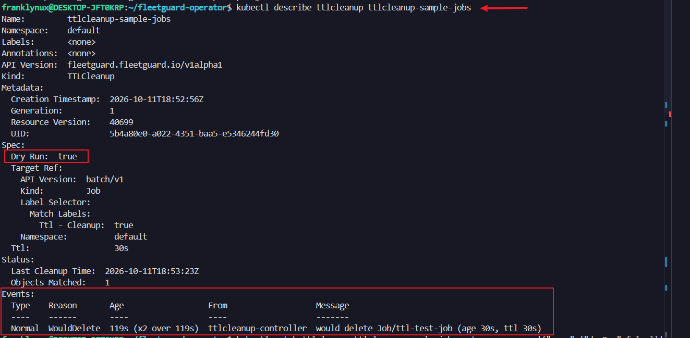
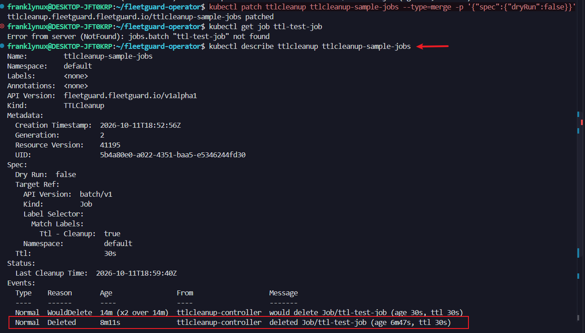
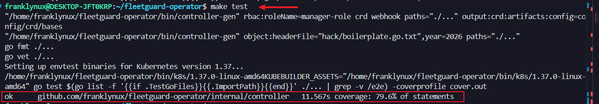
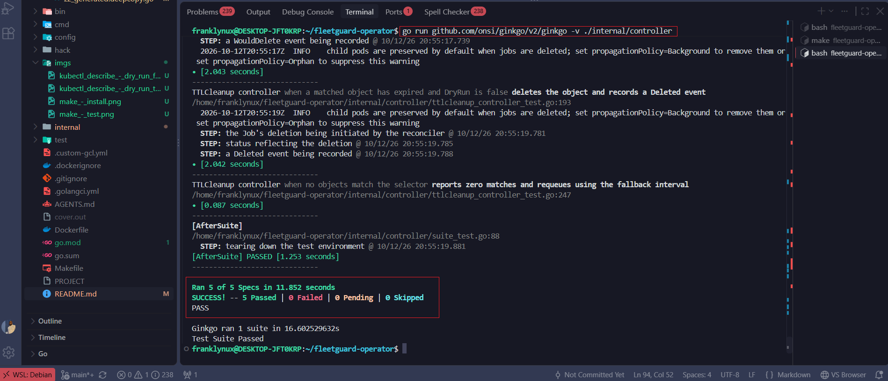
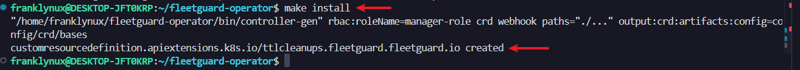
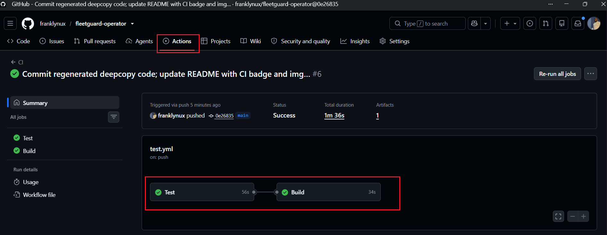

# FleetGuard — Generic TTL Cleanup for Kubernetes

[](https://github.com/franklynux/fleetguard-operator/actions/workflows/test.yml)

A Kubernetes operator that deletes expired resources on a schedule you define, so ephemeral objects (finished Jobs, preview-environment resources, scratch CRs) don't pile up and have to be cleaned up by hand.

## Description

`fleetguard-operator` introduces a custom resource, **`TTLCleanup`**, that watches a set of Kubernetes objects and deletes any that have outlived a configured TTL (time-to-live), measured from their `creationTimestamp`.

Unlike a cleanup script hardcoded to one resource type, a `TTLCleanup` targets **any** Kubernetes `apiVersion`/`kind` — built-in (`Job`, `Pod`) or custom — via a `targetRef`, optionally scoped to a namespace and narrowed with a label selector. Each `TTLCleanup` is independent, so a cluster can run several at once: one sweeping completed Jobs after a day, another clearing out PR-preview namespaces' resources after a week, with no code changes required between them.

Key design points:
- **Generic targeting** — one controller, any resource type, via `targetRef.apiVersion` + `targetRef.kind` + an optional label selector.
- **Dry-run mode** — set `spec.dryRun: true` to log what *would* be deleted (as Kubernetes Events) without actually deleting anything, so you can validate a selector before trusting it in production.
- **Efficient requeueing** — the controller computes the soonest remaining expiry among matched objects and requeues exactly then, rather than polling on a fixed interval.
- **Status visibility** — `status.objectsMatched` / `status.objectsDeleted` and emitted Events give you an audit trail of what the controller is doing.

## Example

```yaml
apiVersion: fleetguard.fleetguard.io/v1alpha1
kind: TTLCleanup
metadata:
  name: cleanup-finished-jobs
  namespace: default
spec:
  targetRef:
    apiVersion: batch/v1
    kind: Job
    namespace: default
    labelSelector:
      matchLabels:
        ttl-cleanup: "true"
  ttl: 24h
  dryRun: false
```

This deletes any `Job` in the `default` namespace labeled `ttl-cleanup: "true"` once it's more than 24 hours old.

### Spec reference

| Field | Type | Description |
|---|---|---|
| `spec.targetRef.apiVersion` | string | API version of the resource to watch, e.g. `batch/v1`. |
| `spec.targetRef.kind` | string | Kind of the resource to watch, e.g. `Job`. |
| `spec.targetRef.namespace` | string, optional | Restrict to this namespace. Omit for cluster-wide (namespace-scoped kinds only). |
| `spec.targetRef.labelSelector` | [LabelSelector](https://kubernetes.io/docs/reference/generated/kubernetes-api/v1.29/#labelselector-v1-meta), optional | Further narrows which objects match. Omit to match all objects of that kind. |
| `spec.ttl` | duration (e.g. `24h`, `30m`) | How long an object may live past its `creationTimestamp` before it's considered expired. |
| `spec.dryRun` | bool, default `false` | When `true`, logs matches via Events instead of deleting. |
| `status.lastCleanupTime` | timestamp | When the controller last completed a reconcile pass. |
| `status.objectsMatched` | int | Objects matching `targetRef` as of the last pass. |
| `status.objectsDeleted` | int | Expired objects deleted in the last pass (always `0` in dry-run). |

## Getting Started

### Prerequisites
- go version v1.26.0+ (the project's `go.mod` pins this; `GOTOOLCHAIN=auto`, the Go default, will fetch it automatically if your installed Go is older)
- docker version 17.03+
- kubectl version v1.11.3+
- Access to a Kubernetes v1.11.3+ cluster (a local [kind](https://kind.sigs.k8s.io/) cluster works well for development)

### Running locally against a cluster

```sh
make install   # installs the TTLCleanup CRD
make run       # runs the controller locally, against your current kube-context
```

In another terminal, apply a sample and watch it work:

```sh
kubectl apply -f config/samples/fleetguard_v1alpha1_ttlcleanup.yaml
kubectl describe ttlcleanup ttlcleanup-sample-jobs
```


Shot: `kubectl describe ttlcleanup` showing a dry-run `WouldDelete` event

Once you're happy with the selector, flip `dryRun` to `false` (e.g. `kubectl patch ttlcleanup ttlcleanup-sample-jobs --type=merge -p '{"spec":{"dryRun":false}}'`) and matching expired objects will actually be deleted:


Shot: showing the target Job gone after a real delete

### Running the test suite

```sh
make test
```

Runs the envtest-backed Ginkgo suite covering TTL expiry math, dry-run vs. real deletion, event recording, and requeue timing — no live cluster required.


Shot: test successful showing `ok` status (all 5 specs passing)


Shot: a green `make test` run using Ginkgo-style(all 5 specs passing)

### To Deploy on the cluster
**Build and push your image to the location specified by `IMG`:**

```sh
make docker-build docker-push IMG=<some-registry>/fleetguard-operator:tag
```

**NOTE:** This image ought to be published in the personal registry you specified.
And it is required to have access to pull the image from the working environment.
Make sure you have the proper permission to the registry if the above commands don't work.

**Install the CRDs into the cluster:**

```sh
make install
```


Shot: `make install` success

**Deploy the Manager to the cluster with the image specified by `IMG`:**

```sh
make deploy IMG=<some-registry>/fleetguard-operator:tag
```

> **NOTE**: If you encounter RBAC errors, you may need to grant yourself cluster-admin
privileges or be logged in as admin.

**Create instances of your solution**
You can apply the samples (examples) from the config/sample:

```sh
kubectl apply -k config/samples/
```

>**NOTE**: Ensure that the samples has default values to test it out.

### To Uninstall
**Delete the instances (CRs) from the cluster:**

```sh
kubectl delete -k config/samples/
```

**Delete the APIs(CRDs) from the cluster:**

```sh
make uninstall
```

**UnDeploy the controller from the cluster:**

```sh
make undeploy
```

## Project Distribution

Following the options to release and provide this solution to the users.

### By providing a bundle with all YAML files

1. Build the installer for the image built and published in the registry:

```sh
make build-installer IMG=<some-registry>/fleetguard-operator:tag
```

**NOTE:** The makefile target mentioned above generates an 'install.yaml'
file in the dist directory. This file contains all the resources built
with Kustomize, which are necessary to install this project without its
dependencies.

2. Using the installer

Users can just run 'kubectl apply -f <URL for YAML BUNDLE>' to install
the project, i.e.:

```sh
kubectl apply -f https://raw.githubusercontent.com/<org>/fleetguard-operator/<tag or branch>/dist/install.yaml
```

### By providing a Helm Chart

1. Build the chart using the optional helm plugin

```sh
kubebuilder edit --plugins=helm/v2-alpha
```

2. See that a chart was generated under 'dist/chart', and users
can obtain this solution from there.

**NOTE:** If you change the project, you need to update the Helm Chart
using the same command above to sync the latest changes. Furthermore,
if you create webhooks, you need to use the above command with
the '--force' flag and manually ensure that any custom configuration
previously added to 'dist/chart/values.yaml' or 'dist/chart/manager/manager.yaml'
is manually re-applied afterwards.

## Known limitations

The controller's RBAC is intentionally broad (`groups=*,resources=*` for get/list/watch/delete) because `TTLCleanup` is designed to target arbitrary resource kinds via `targetRef` rather than a fixed, known set. If you only ever point it at a small number of kinds in your cluster, consider scoping `config/rbac/role.yaml` down to just those `apiGroups`/`resources` after generation.

## Contributing

Issues and pull requests are welcome. Run `make test` before submitting a PR — CI runs the same suite on every push and PR to `main`.


Shot: a passing GitHub Actions run under the repo's Actions tab

**NOTE:** Run `make help` for more information on all potential `make` targets

More information can be found via the [Kubebuilder Documentation](https://book.kubebuilder.io/introduction.html)

## License

Copyright 2026.

Licensed under the Apache License, Version 2.0 (the "License");
you may not use this file except in compliance with the License.
You may obtain a copy of the License at

    http://www.apache.org/licenses/LICENSE-2.0

Unless required by applicable law or agreed to in writing, software
distributed under the License is distributed on an "AS IS" BASIS,
WITHOUT WARRANTIES OR CONDITIONS OF ANY KIND, either express or implied.
See the License for the specific language governing permissions and
limitations under the License.